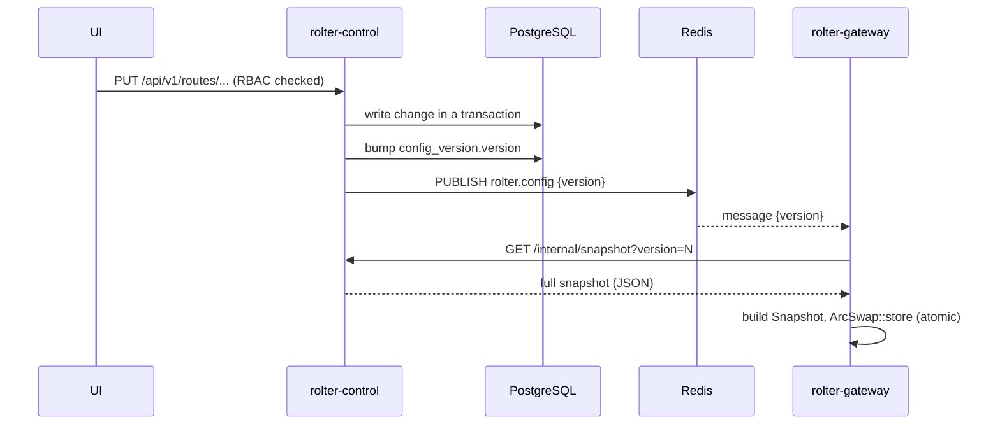

# Configuration & hot reload

A core requirement: operators change routes, providers, keys, limits and pricing from the UI and have them take effect **without restarting** the gateway.

## Sources of config

1. **Bootstrap file** (`rolter.toml`) — used for first run, local dev, and IaC. Maps to `rolter_core::GatewayConfig`.
2. **Database (Postgres)** — the runtime source of truth once the control plane is running. The control plane composes a `GatewayConfig`-equivalent snapshot from normalized tables.

### Bootstrap file plus database (merged mode)

`rolter control --config rolter.toml --database-url ...` (which `rolter easy-up` also runs) wraps the Postgres store in `MergedConfigStore`: `load()` starts from the file and decides, table by table, which side the snapshot takes. Without `--config` the pure `PostgresConfigStore` projects every store-owned table and the file does not exist. The owner per `GatewayConfig` field in merged mode:

| Fields                                                                                                                                                                            | Owner in merged mode                                                                                                                                                                                                                                                                                                                                                     |
| --------------------------------------------------------------------------------------------------------------------------------------------------------------------------------- | ------------------------------------------------------------------------------------------------------------------------------------------------------------------------------------------------------------------------------------------------------------------------------------------------------------------------------------------------------------------------ |
| `providers`, `routes`, `provider_groups`, `virtual_keys` / `db_virtual_keys`, `model_prices`, `budgets`, `rate_limits`                                                            | both: the file's rows win a name collision in the same namespace and the store's rows extend them; an org's stored row a global file row shares a name with is kept, shadows it for that org's keys only and is listed as a warning in `GET /api/v1/config/problems` (#3516, ADR-0040 addendum); the CRUD API refuses to edit a file provider, route or group (ADR-0022) |
| `guardrails`, `guardrail_webhook`, `semantic_guards`                                                                                                                              | both: file rules win a name collision, registry rules extend them; the file webhook runs beside the registry's providers                                                                                                                                                                                                                                                 |
| `mcp_servers`, `mcp_oauth_sessions`, `feature_flags`                                                                                                                              | the store only (the flags are control-plane gates, and a file that sets one is ignored)                                                                                                                                                                                                                                                                                  |
| `retry`, `timeouts`, `queue`, `compatibility`, `adaptive_routing`                                                                                                                 | the store, **unless it still holds its seeded defaults**, in which case the file's value stands (#2931)                                                                                                                                                                                                                                                                  |
| `client`, `security`, `model_defaults` (Client Settings, Security, Model Settings)                                                                                                | the store, **unless it still holds its seeded defaults**, in which case the file's value stands (#2922)                                                                                                                                                                                                                                                                  |
| `logging`                                                                                                                                                                         | field by field: the store's `sample_rate`, `payload_capture` and `ui_events`, under the same rule (#2931); the file's `clickhouse_url`, `batch_max`, `flush_ms` and `queue_capacity` always, since `logging_settings` has no column for them                                                                                                                             |
| `prompt_templates`, `plugins`                                                                                                                                                     | both: every stored template and enabled plugin is served, and a file entry survives unless the store has the same one (#2922)                                                                                                                                                                                                                                            |
| `server`, `tls`, `currency`, `unpriced_policy`, `cooldown`, `cache`, `responses`, `health`, `breaker`, `metrics_scrape`, `realtime`, `usage_recording`, `egress`, `pii_sanitizer` | the file; no store table exists for them (`cache.enabled`, `health.enabled` and `breaker.enabled` follow their feature flag)                                                                                                                                                                                                                                             |
| `models`, `provider_defaults`, `provider_group_defaults`                                                                                                                          | the file, as seed input only: `rolter-seed --import` and the control plane's startup seeding copy them into the store                                                                                                                                                                                                                                                    |

Before #2922 `client`, `security`, `model_defaults`, `prompt_templates` and `plugins` were in the file row: what an admin saved on those screens was stored and bumped `config_version`, but the snapshot kept carrying the file's value, so no gateway ever saw it. Before #2931 the other singletons went the opposite way: `retry`, `timeouts`, `queue`, `compatibility`, `adaptive_routing` and `logging` were copied from the store unconditionally, so a store nobody had written replaced the file's value with its defaults, and the file's `clickhouse_url` and batching with them.

The "never written" rule exists because the singleton tables are seeded by their migration, so a store nobody has saved projects exactly `Default::default()` and is indistinguishable from an admin who saved the defaults. Treating that state as "the store has an opinion" would turn a `[security] required_headers` in an existing file into "no rules" on upgrade, so the file's value is used while the store equals the default and the store's value wins outright once it differs (the whole screen, not field by field). The one corner it cannot tell apart is an admin saving the defaults back over a differing file value: the file's value applies again, and is cleared by editing the file. `merged_store_a_migrated_store_projects_the_defaults_of_the_settings_it_owns` pins the premise against a migrated schema.

Prompt templates and plugins have no `ConfigOwned` guard in the CRUD API, so a file entry is not read-only in the dashboard. The store therefore wins a collision here, the reverse of providers: a file entry that won would silently shadow a version an admin published. A stored template's id is `{org_id}:{slug}` and a file template's is the bare id, so they are matched on the slug; `rolter-seed --import` copies a file template into the store under the slug the file names it by, which is what keeps the imported copy and the file's from both running on one request. Plugins are matched on `(org_id, project_id, slug)`. A store with no published template leaves the `[prompt_templates]` block exactly as the file wrote it, and a file block with `enabled = false` contributes no templates beside the store's.

## Propagation

- The gateway keeps the routing table in an `ArcSwap<Snapshot>`. Swapping is atomic and wait-free for readers — in-flight requests keep using the old snapshot; new requests see the new one.
- **Versioning**: `config_version` in Postgres is the monotonic source of truth. The gateway also reconciles on an interval (and at startup) so a missed pub/sub message self-heals.
- **Validation**: the control plane validates a snapshot (every route target references a known provider, etc.) before bumping the version, so gateways never load a broken config.
- **Per-row resilience**: validation used to be all-or-nothing, so a single half-built row 500'd `/internal/snapshot` and froze config propagation for _every_ tenant. Rows that are unservable only by themselves are now **omitted from the snapshot** instead. That covers both a route with no usable target (created before its targets are added, or pointing at a deleted provider) and a **provider whose own definition is invalid** — a malformed `api_base`, a hosted adapter missing its `api_key_env`. Dropping a provider also drops every reference to it, before the route pass (#2945): `prune_omitted_provider_targets` removes each route target, variant target and provider-group member that names it, one problem line each, the way `prune_cross_project_targets` does for a cross-project scope (both run through `prune_targets_where`, which also removes a variant left with no target, since `validate` reads a targetless variant as a defect and would refuse the snapshot over it). Only then does the route pass drop a route left with nothing to serve, so a route is lost only when nothing else on it can serve. Before this, a route naming the omitted provider beside a healthy one kept the dangling target and `validate_snapshot` refused the whole snapshot for every tenant, which is the blast radius #926 set out to remove. `prune_omitted_provider_settings` repairs the two references that are not targets, after the route pass so a dropped route does not also report them. A route's **semantic cache** whose embeddings provider was omitted is switched off for that route (the route keeps serving, and keeps its exact-match cache), with a problem line. A **virtual key's `providers` allow-list** loses the omitted names only while it stays non-empty: an empty list means every provider (`KeyMeta::provider_allowed` in the gateway), so a key that allowed only omitted providers would be _widened_ by the same edit. That key is left out of the snapshot instead, which denies it, with a problem line; this applies to the file's keys and the store's alike. No other field names a provider (health probing, queues, the metrics scrape, retry and breaker settings apply to every provider; model defaults name a model; budgets and rate limits name scope ids), and a name another provider still carries is not treated as omitted. The same pass prunes a reference to **another org's provider** (#1857, ADR-0040): a row's provider names resolve in the row's own org, then globally, and never to another org (`Namespaced::resolve_ref`), so a bootstrap-file route or group naming a stored provider, which belongs to an org, loses that target with the problem line "a deployment-wide row uses deployment-wide providers only", and an org row naming another org's provider with "the provider belongs to another organization", rather than serving one org's credential to other orgs' keys or refusing the snapshot. Only names omitted _here_ are pruned: a name no provider ever carried (a typo in a file config) still fails `validate_snapshot`, and the store loader's own pruning from #2943 stays, since it covers the _database_ routes and groups of a provider the loader left out before this pass can see it. The file's own references need the names too (#2950): `load_providers` returns them, `PostgresConfigStore::load` puts them in `GatewayConfig::left_out_providers` (`#[serde(skip)]`, so it never reaches a file or the wire), `MergedConfigStore::load` carries them into the merged config, and `sanitize_for_snapshot` adds them to the omitted set unless a provider of that `(org, name)` is still present. The set is keyed by `(org, name)`, global rows under the empty org, since two orgs may each have a provider of one name (#3464): the loader skips a stored target or group member only when its provider row, which it names by id, is the one left out, and the sanitizer resolves a reference to a left-out provider by `Namespaced::resolve_ref` like any other, so one org's unreadable `openai` prunes that org's references alone, and its own routes do not fall through to a global `openai` the left-out row would have shadowed. A bootstrap-file route, variant, group member, semantic cache or key allow-list that names a stored provider the loader left out is then pruned with the same problem lines and decisions as above, instead of dangling and refusing the snapshot. **Prompt templates** are pruned the same way (#2279): each published `(id, version)` is validated on its own through `PromptTemplatesConfig::template_problems`, which runs the same `validate` the whole config does over a one-template config, and an invalid one is omitted with a problems entry naming it and the reasons. Nothing references a template from outside it (scopes live on the template), so the prune leaves no dangling reference. The first line of defence is the control plane: `POST .../versions` and publish/rollback refuse, with a 400 listing the problems, content that check would reject, so the prune only has to cover rows written before that check or by other paths (seed, import, SQL). A route's `advanced.guardrails` `disable`/`enable` entry that names a guardrail rule no enabled row carries is **pruned from that route** with a problem line (#2306): the store loads only enabled rows, so pausing, renaming or deleting a dashboard rule would otherwise strand every override naming it and 500 the snapshot. Pruning is safe both ways — an `enable` for a missing rule has nothing to enable and a `disable` for a rule that is not running has nothing to switch off. Only the snapshot path prunes; `validate` still rejects an unknown name in a file config, where it is a typo and a typo in `disable` must not read as "this rule is off here". The problem text does not tell a paused rule from a never-defined one. A route's `advanced.headers` entry that the wire cannot carry, or that names a credential or a framing header, is pruned the same way (#2924): `AdvancedModelConfig::drop_unsendable_headers` removes just that header and the route keeps serving, `validate` still rejects it in a file config, and the control plane refuses it on write. See [Route advanced settings](route-advanced-settings.md). A **`client.request_id_header`** that is not a header name, or that names a credential, session or framing header (`rolter_core::request_id_header_problem`: the route-header reserved list plus `cookie` and `set-cookie`), is reset to `x-request-id` with a problem line (#2925), because the gateway would otherwise copy a caller's credential into the request log and onto the response, or write the id over a framing header. `validate` rejects it in a file config, the control plane refuses it on write, and the gateway's `trace::request_id_header_name` falls back to the default on its own for a config that skipped both. A **model price** with a negative rate is pruned the same way (#2889), since priced as written it would turn a request into a credit against its budget and repairing it to zero would make the model free: the row is omitted with a problem line and the model is unpriced, which `unpriced_policy` already answers. `ModelPriceConfig::rate_problems` is the check; `validate` runs it too, so a file config with a negative rate is refused. A rate Postgres can hold but a `Decimal` cannot (`NaN`) never reaches the config at all: the store's loader leaves that price out and logs it, and `load_problems` reports it. A **route whose `advanced`, `params` or `param_policy` jsonb does not deserialize** is omitted the same way (#2938), and the reason is that the alternative fails open: the loader used to read the blob as the type's default, which is public visibility with no `project_only`, no team, key or user allow-list, no guardrail override and no limit (`advanced`), caller-overridable admin defaults (`param_policy`, whose default mode is `allow`) and no admin defaults at all (`params`, which can carry a spend bound such as `max_tokens`). So a route a project admin had restricted to two teams became visible to every key in the org, silently. `route_settings_from_row` in `postgres/mod.rs` reads the three columns and names the one that failed; `load_routes` leaves that route out with a warning, and `load_problems` lists it in `GET /api/v1/config/problems`. All three fail closed rather than degrade, because each default is the permissive one and the model answers as unknown until the row is repaired, which an operator can see. The control plane parses every write through the same types, so reaching this takes a row written by SQL or a seed, or a later change to a type that old rows no longer fit; an empty `{}` is what a route that never set the column holds and stays valid. A **provider whose `egress_proxies` does not read as a list of strings** is omitted the same way (#2943), because the old reading was an empty pool, which is the permissive one: the provider fell back to its single `egress_proxy`, or to a direct connection, and traffic the operator had forced through a proxy left without it. `egress_proxies_from_value` reads the column; `load_providers` leaves the provider out with a warning and returns the names it left out, which `load_routes` and `load_provider_groups` use to skip every target and group member that names one. That last step is not optional: `sanitize_for_snapshot` drops a route only when _none_ of its targets is servable, so a dangling name on a route with a second target would survive it and make `validate_snapshot` refuse the snapshot for every tenant, turning one provider's defect into a fleet-wide one. A route left with no target goes through the usual "no servable target" pruning and is named in the snapshot's `problems`; `load_problems` lists the provider itself. The Providers API still lists such a provider and can repair it (#2946): the row type's `egress_proxies` is the `EgressProxies` wrapper in `postgres/models.rs`, which keeps the string entries, drops the rest with a warning and reads a non-array as empty, so `list`, `get` and the `returning` of create/update no longer fail the row's decode. That view is for editing only; traffic safety rests on the loader above, which reads the raw value. A **`security_settings.required_headers` that does not read** (not an object, an entry whose value is not a non-empty string, a blank header name, or one header written twice with different values) is _not_ pruned, because it is not a row among others: it is the deployment-wide ingress gate, and both ways of continuing are fail-open or worse (leaving the row out, or reading it as the default, drops the gate; guessing a value invents a rule nobody wrote and can lock every tenant out). `PostgresConfigStore::load` returns an error instead (`required_headers_from_value`), before it builds anything, so `/internal/snapshot` answers 500 and no snapshot carrying a weaker gate is ever published. A gateway that already holds a snapshot keeps it, gate included: `watcher::poll_once` treats a non-success status as a failed poll, counts it in `rolter_config_reload_failures_total`, and does not call `reload` (`a_refused_snapshot_leaves_the_gate_the_gateway_already_holds`). The refusal says why on both sides (#2947): `build_snapshot` answers a failed load with `error.problems` taken from `ConfigStore::load_problems` (never a driver error or a value, and left out when the store has nothing to say), and `poll_once` reads at most 8 KiB of a non-success body and appends `error.message` and `error.problems` to the `config snapshot poll failed` line, so a gateway's log names the setting. Nothing from that body is applied. A gateway that _starts_ while the row is unreadable has only its own bootstrap config, and a gateway started with `--snapshot-url` treats an empty key set as closed (`managed_auth`, `managed_gateway_denies_when_the_key_set_is_empty`), so it refuses every `/v1` request until the row is repaired unless its bootstrap file carries virtual keys of its own, in which case it serves on the file's `[security]` alone. Two things keep this recoverable. `GET /api/v1/config/problems` still answers: when `load` fails, `get_config_problems` falls back to `ConfigStore::load_problems`, which names the setting and each entry at fault (never a value, since it may be a shared secret), and stays the opaque 500 only when the store has nothing to say. And `GET`/`PUT /api/v1/security-settings` read and write the row through `SecuritySettingsRepo`, not through `load`, so the setting is repaired where it lives and the next snapshot carries the rule again. The price is that every dashboard read that goes through `ConfigStore::load` (`GET /api/v1/config`, the model list, the config export, the UI-event intake) is a 500 for as long as the row is unreadable; that was accepted because the state needs a row written around the API to reach, and migration 0086 (below) now stops it being written. **`client_settings.injected_headers`** is the one that degrades instead (`injected_headers_from_value`): it adds a header to an upstream request and gates nothing, so serving without the entry that cannot be read is a smaller service rather than a wider one, and the omission is a warning in the log and a line in `GET /api/v1/config/problems`. Migration `0086_security_egress_settings_shape.sql` adds a `not valid` check to each of the three columns (an object, or an array, of strings with no blank name or required value), so the database refuses what the API already refuses; it validates each check it can and leaves one unvalidated, with a notice, where a row already breaks it, the same pattern as 0084. Structural problems that span rows (duplicate names, a bad `metrics_path`, unreadable CA bundles) still fail the whole snapshot, since silently dropping one of two colliding rows would be worse than refusing.
- **Saying what was dropped** (#926): omitting an entry quietly is its own failure mode — every gateway keeps serving its last good config, so nothing looks broken until a gateway restarts cold or someone wonders why a change never took effect. So the reasons travel with the config:
  - `/internal/snapshot` carries a `problems: [...]` array alongside `version` and `config`, present only when something was dropped. It is absent from a healthy snapshot, which is what every gateway in the fleet transfers on every poll.
  - the gateway logs them **once per change**, at the point it applies a new version, rather than once per poll — a fleet polling every 5s would otherwise repeat the same complaint thousands of times a day. An older control plane sends no such field, so it defaults rather than failing the decode during a rollout.
  - the dashboard reads `GET /api/v1/config/problems` and shows them on the Providers screen. That endpoint runs the same computation the snapshot does, so the two cannot disagree; it also reports structural problems, which never reach a gateway at all.
  - the Effective config screen (`ui/src/pages/Config.tsx`) lists the same lines above its tables and marks each provider and route row the snapshot leaves out, with the reason (#2085). The endpoint also answers `omitted: [{kind, name, reason, index}]`, built where `sanitize_for_snapshot_report` (and, for the public example key, `prune_public_example_key`) drops the entry, so no client parses a sentence (#1876). `index` is the row's position in the list the store loaded, which is its position in the matching list of `GET /api/v1/config`; that response strips tenancy, so two scopes' routes can share a model and two file keys a name, and only the row at `index` is marked (the dashboard also checks that it still carries `name`). `ui/src/lib/api/config.ts` reads it through `omittedRows()` (the Config tables) and `unservedModels()` (the Playground). The screen asks for the problems even when the config read fails, since an unreadable `security_settings.required_headers` fails `load` while the problems endpoint still answers (#2943). For a caller with `cluster_node:read` it also reads `GET /api/v1/cluster/nodes` through `gatewayPickup()` and says how many live gateways run the current config version, with a link to Cluster; no other caller gets that line, and nothing renders in a success colour while the config read is failed or pending.
  - that endpoint also appends `ConfigStore::load_problems`: rows the store's loader could only map onto the config by guessing, such as a budget whose stored `period` it does not recognise and enforces as monthly (#1902). The snapshot carries the guess rather than the row, so only the store can say where one was made. Those lines are not in the snapshot's `problems`, because nothing was dropped: the gateway serves the row, just not as the row says.
- `GET /api/v1/config` is the dashboard's read-only view of the same document. It needs a session of any role (or the admin token, or open mode; #1840), and is still **redacted before it leaves the control plane** (`redact_config_for_dashboard`): provider credentials, the plaintext of `[[virtual_keys]]`, the digests of database keys and every MCP OAuth session are removed, and userinfo is stripped from the ClickHouse and egress-proxy URLs. Anything a gateway needs to authenticate with comes only through the token-guarded `/internal/snapshot` (#1212).

## Snapshot format

The snapshot's `version` says when the config last moved; its `format` says
what shape the payload has ([ADR-0038](../adr/2026-10-27-snapshot-format-version.md), #1512).
The constants and the negotiation live in `rolter_core::snapshot_format`, which
both binaries share: `SNAPSHOT_FORMAT` (what this build writes and reads),
`MIN_SERVED_FORMAT` (the oldest format a control plane of this build serves)
and `FormatRange`.

- **The request.** The gateway sends `formats=SNAPSHOT_FORMAT` beside
  `version` on every poll, and on the early log-destination read. An absent
  `formats` is a gateway that predates negotiation, which reads format 1 only.
- **The control plane** (`build_snapshot`, with the helpers in
  `crates/rolter-control/src/snapshot_negotiation.rs`) records the heartbeat,
  then negotiates _before_ the `304` and before the store is read: a value that
  does not parse is `400 invalid_query`, and a range with nothing in common
  with what it serves is `406 snapshot_format_unsupported`, so a gateway that
  cannot be served learns it on its next poll even when nothing changed, at no
  database cost. Otherwise it serves the highest common format. When that is
  older than its own, the `DownStep` chain converts: each step's `omit` runs on
  the typed config before `sanitize_for_snapshot`, so the cascade removes what
  referenced an omitted entity and the lines ride out in `problems`; each
  step's `rewrite` runs on the serialized config. A step that cannot express a
  deployment-wide setting answers `406 snapshot_format_inexpressible`. The
  answer carries `format`, and `Deprecation` and `Sunset` when the format is a
  `Target::SnapshotFormat` entry in `DEPRECATIONS` (the `304` included). A
  refusal is logged at `warn` once per node, range and code in each process,
  and recorded as `outcome = refused` on `rolter_snapshot_build_ms`.
- **The gateway** (`watcher::poll_once`) reads `format` over the reply's bytes
  before it decodes `config` (`FormatHead`; absent is 1), so a mismatch is
  reported as one rather than as a serde error. A `406`, or a `200` in a format
  it does not read, applies nothing: it sets `rolter_snapshot_format_refused`,
  logs one `error` on the transition into that state, and the poll fails as
  any failed poll does. A compatible `200` or `304` clears the gauge, and an
  applied snapshot sets `rolter_snapshot_format`. A `Deprecation` header is
  warned about once per process. `/readyz` answers
  `503 snapshot_format_unsupported` only while no snapshot was ever applied
  (see [Health and readiness](health-and-readiness.md)).

This release writes format 1 and serves only format 1, so `DOWN_STEPS` is
empty; the tests in `snapshot_negotiation.rs` and `watcher.rs` pass a served
range and a test-only chain to stand in for a second format. A change to the
payload is classified under ADR-0038 section 2; the `Changed the snapshot
payload` row of the AGENTS.md maintenance matrix is the checklist, and the
shape guard in `snapshot_format.rs` (`crates/rolter-core/tests/fixtures/snapshot_shape.json`,
regenerated with `ROLTER_TEST_UPDATE_SNAPSHOT_SHAPE=1`) fails on a removed path
or a changed JSON type within one format. It reads the shape off
`tests/fixtures/snapshot_representative.json`, a config with at least one
element in every list, and `the_representative_config_populates_every_list`
fails when a list serializes empty, so a new `Vec` field needs an element there
before the guard can see what it holds.

### Enum values a gateway does not know

Every enum reachable from `GatewayConfig` that can grow a value either has a
fail-closed `Unknown` variant (`#[serde(other)]`), or says in its doc comment
that it is deliberately closed (#3347). A value from a newer release then
decodes as `Unknown` instead of failing the whole snapshot, which would keep an
older gateway on its last config, every revoked key included, until it is
upgraded. `GatewayConfig::fail_closed_unknown_values`, which the gateway runs on
every snapshot before it validates one, decides what `Unknown` means, for that
entity alone:

| Enum                                                                                  | `Unknown` reads as                                                                                                                                                  |
| ------------------------------------------------------------------------------------- | ------------------------------------------------------------------------------------------------------------------------------------------------------------------- |
| `ProviderKind`                                                                        | the provider is omitted and never dialled; the sanitizer's cascade drops the route targets, group members and key allow-list entries that named it                  |
| `BalancingStrategy`                                                                   | a route is omitted (a request for it is answered as for an unknown model); a provider group keeps no members                                                        |
| `BudgetPeriod`                                                                        | the budget refuses every request it covers, before Redis is read                                                                                                    |
| `BudgetScope` (budgets and rate limits)                                               | the cap counts every request, on a counter of its own, so it binds sooner than configured                                                                           |
| `UnpricedPolicy`                                                                      | `block`                                                                                                                                                             |
| `FailureMode` (guardrail webhook, semantic guard providers, PII sanitizer, plugins)   | `fail_closed`                                                                                                                                                       |
| `OnTruncated` (a local semantic guard provider's `on_truncated`, #3513)               | `fail_closed`                                                                                                                                                       |
| `GuardAction`, `ViolationAction`                                                      | `block`                                                                                                                                                             |
| `StreamingPostCall`, `StreamingStrategy` (semantic guards), `StreamingResponse` (PII) | `reject`                                                                                                                                                            |
| `SanitizeDirection` / `RestorationPolicy`                                             | `both` / `never`                                                                                                                                                    |
| `OverrideMode` / `BackpressurePolicy` / `RoleProfile`                                 | `deny` / `error` / `system_only`                                                                                                                                    |
| `GuardProviderKind` (semantic guard providers, #3329)                                 | kept: the provider blocks its stage per request, whatever its `failure_mode` (ADR-0039); no known kind is a safe reading of it                                      |
| `McpAuthKind` (#952)                                                                  | the server is refused, in the MCP proxy                                                                                                                             |
| `FailureClass` (a route target's `takes_over`, #3390)                                 | kept in the set but matches no failure, so the target stays a fallback that is never dialled for it; dropping it would empty the set and put the target in the pool |

Each value read this way is logged once per applied snapshot at `warn`, and
counted (#3424): `GatewayConfig::fail_closed_unknown_report` returns the same
lines with a count per _kind_ (`UnknownValues::kinds`), and the watcher sets the
gauge `rolter_snapshot_unknown_values{kind}` from it once the snapshot applies,
back to `0` for a kind the new snapshot no longer carries. A kind is a fixed name
for the enum or entity (`provider_kind`, `route_strategy`, `provider_group_strategy`,
`budget_scope`, `budget_period`, `rate_limit_scope`, `failure_class`,
`unpriced_policy`, `queue_backpressure`, `role_profile`, `param_policy_mode`,
`guard_action`, `streaming_post_call`, `failure_mode`, `on_truncated`, `violation_action`,
`streaming_strategy`, `guard_provider_kind`, `pii_direction`, `pii_restoration`,
`pii_streaming`, `mcp_auth_kind`), never the value or the entity's name, so the label set is bounded
by the build and leaks no tenant data. A budget or rate limit whose scope or period
stays `Unknown` is counted and logged there too. On the control plane,
`ConfigStore::load_problem_records` lists each stored row whose value reads this
way in `GET /api/v1/config/problems` (#3446, `unknown_value_problems` in the
postgres store): a route's strategy, a provider's kind and an MCP server's auth
kind, owned by the row's tenant, and a budget's or rate limit's scope, owned by the
deployment (no known scope names a tenant), beside the budget period (#1902) and
the `takes_over` class (#3321) it already named. The postgres store reads a stored provider kind it
does not know as `ProviderKind::Unknown` (#3469) and a route strategy the same
way, so one such row never fails the load for every tenant; the sanitizer then
leaves it out. A budget or rate limit on a stored `scope_type` it does not know is loaded
as `BudgetScope::Unknown` (#3470), and so binding, rather than skipped, which
left the cap unenforced. The
control plane's sanitizer applies the same readings, so an older control plane
reading a newer row serves them too. A config file is written by hand, so there
an unknown value is a typo: `GatewayConfig::from_toml_str` refuses it, and the
control plane's API refuses one on input.

The closed enums are those whose unknown value has no reading that can only
narrow what is served: the data-carrying `ScopeWithin`, `WebhookAuth` and
`PromptTemplateActivationScope`, the stages (`WebhookStage`, `GuardStage`,
`PluginStage`), `BuiltinRule`, `PolicyScope`, and the decorator's `DecoratorRole`
and `DecoratorPosition`. `FailureKind` is closed too, but never read from the
wire: it is the gateway's own classification of a failure, and only the
`FailureClass` that names one travels in the snapshot. A new value in one of them is a format bump under
ADR-0038 section 2. A new value in an enum with a fallback is additive, provided
its `Unknown` reading still holds for it; a new enum in the payload gets one or
the other.

## Why this design

- Redis pub/sub gives near-instant fan-out to many gateway replicas.
- Postgres versioning makes the system correct even if Redis drops a message.
- `ArcSwap` keeps the hot path lock-free; no read ever blocks on a config write.

Alternatives considered: Postgres `LISTEN/NOTIFY` (avoids a Redis dependency but Redis is already needed for cache/rate limits), and pure polling (simplest, higher latency). See [ADR](../adr/README.md).
