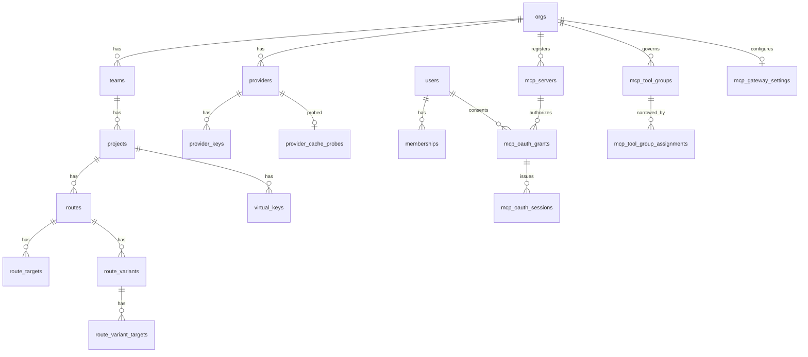

# Data model

PostgreSQL is the source of truth. The initial schema lives in [`migrations/0001_init.sql`](../../../crates/rolter-store/migrations/0001_init.sql); ClickHouse log schema in [`clickhouse/001_logs.sql`](../../../clickhouse/001_logs.sql).

## Tenancy



- **Org → Team → Project → Virtual Key** is the hierarchy. Budgets and rate limits attach at any scope and combine **most-restrictive-wins**.
- **Providers** are owned at the org level and referenced by route targets. Upstream credentials live in `provider_keys`, **envelope-encrypted** (see [security.md](security.md)).
- **Provider cache probes** (`provider_cache_probes`, #984) hold at most one row per provider: whether a one-token completion from that provider carried a prompt-cache usage field (`reports`, the `spelling` found as a JSON pointer, the probed `model`, `probed_at`). Written by `POST /api/v1/providers/{id}/probe-cache`, matched against `rolter_proxy::cached_prompt_tokens_spelling` so "reports" means the gateway would see a hit. No row means never probed, which the dashboard shows apart from "does not report". The gateway never reads it, so it has no `bump_config_version()` trigger and a probe does not reload the data plane.
- **Price provenance** (`model_prices.source`, `source_imported_at`, `0126`, #966): a row an operator wrote has both `null` and is an override; a row `ModelPriceRepo::import_catalogue` wrote names its catalogue (free text, since the importer is source-agnostic) and the snapshot's date. `upsert` resets both to `null`, so editing an imported price makes it an override, and the import's `on conflict … where model_prices.source is not null` is what keeps an override from being replaced. No new trigger: `0004`'s fires on any write. The adapter is `rolter-control/src/price_catalogue.rs` (`PriceSource`, `LiteLlm`), reading `crates/rolter-control/catalogue/litellm-prices.json`, which `scripts/refresh-price-catalogue.ts` (`just refresh-prices`) cuts down from upstream with the MIT notice beside it; the file has no currency field so the adapter stamps USD. It is compiled in (`include_str!`), never fetched, and excluded from prettier and typos.
- **Routes** belong to a project and map a public `model` to `route_targets` with a `strategy`. A target's `takes_over` (`text[]`, `0129_route_target_takes_over.sql`, #1584) holds the failure class tokens it is a fallback for, `'{}'` for an ordinary target; the `0003` trigger on `route_targets` already bumps `config_version` for it. A target matched by `RouteRepo::update` is rewritten when its weight or its `takes_over` changed, and the snapshot drops a target whose class does not parse and a route left with only restricted targets, with a warning, rather than serve either open (see [Load balancing](load-balancing.md#fallback-targets-that-take-over-failure-classes)).
- **Virtual keys** belong to a project, store only a hash of the key plus a display prefix, and carry an optional model allow-list.
- **MCP servers** belong to an org and declare required OAuth scopes and exposed tool names. Only enabled servers reach gateway snapshots. Grants bind a user to a server; sealed token sessions belong to a grant. **MCP tool groups** persist named server/tool manifests, while **MCP gateway settings** hold organization defaults for registration and MCP-aware clients; the gateway enforces the groups (and a server's declared manifest) as a request-path boundary (see [mcp-oauth.md](mcp-oauth.md)). A group can be narrowed to callers through `mcp_tool_group_assignments` (`0150`, trigger `0151`, #3295): `(group_id, subject_kind, subject_id)` with `subject_kind` in `virtual_key`, `project`, `team`, cascading with the group and carrying no foreign key on the polymorphic subject, so delete triggers on `virtual_keys`, `projects` and `teams` (`0200`, #3382) remove a deleted subject's rows. A caller named by no assignment keeps the organization-wide groups.
- **Provider groups** (`provider_groups`, `provider_group_members`) are org-scoped and address a fleet of same-kind providers as one `group-slug/model` name. The slug shares the provider slug namespace; a member's `weight` and `position` feed the group's balancing strategy, and a null `upstream_model` forwards the requested model unchanged.
- **Labels** (`labels`) attach a `(key, value?)` fact to a provider, provider group, route or model. `source` separates an operator's `custom` label from an `auto` one Rolter derived, and is part of the uniqueness constraint so the two never overwrite each other; `auto` rows additionally carry `observed_at`/`observation`. `subject_id` is text because a model is addressed by name, which rules out a foreign key — three `after delete` triggers sweep a subject's labels instead. A model label may carry `org_id`, the org whose model it is (#3476); null is deployment-wide, and the uniqueness treats null as one owner. See [labels.md](labels.md).

## Cost & limits

- `model_prices` — USD per million tokens for input/output (+ cached input, + cache write). Used to compute `cost_usd` per request, written to ClickHouse. `audio_input_per_mtok`, `audio_output_per_mtok` and `cached_audio_input_per_mtok` (`0092`, #1882) are the rates for the audio share of a realtime or audio model's tokens; `null` charges those tokens at the text rate (the cached one at `cached_input_per_mtok`, then the audio input rate), which is every row that existed before the migration. They need no trigger, carry the same `>= 0 and not NaN` check, and are tri-state on `UnitRates` beside the unit rates. The dashboard sets them from the Pricing screen and from an audio model's sheet (#3145), which names each through `keptRatePatches()` (`ui/src/lib/cache-write-rate.ts`) only when its input was edited. `image_per_unit`, `audio_input_per_minute` and `speech_per_mchar` (`0090`, #2937) are the rates for requests billed by the image, the minute of audio and the million characters of speech input; `null` charges nothing for that unit, which is every row that existed before the migration. They need no trigger (`0004`'s fires on any write), carry the same `>= 0 and not NaN` check as the token rates (validated as added, the columns being new), and are tri-state on `ModelPriceRepo::upsert` through `NewModelPrice::units` (`UnitRates`) for the reason `cache_write_per_mtok` is: a `NewModelPrice` that leaves `units` at its default names none of them and keeps what is stored. `cache_write_per_mtok` (`0083`, #2876) is the rate for input tokens written to the provider's prompt cache; `null` means the input rate, which is what every row charged before the column existed. It needs no trigger of its own, since the statement-level `model_prices_bump_config_version` from `0004` fires on any write to the table. It is also the one column `PUT /api/v1/model-prices` does not replace: `ModelPriceRepo::upsert` takes it as `Option<Option<&str>>` (`None` keeps the stored rate, `Some(None)` clears it), because a client that predates the column sends a body without it and "omitted means null" would wipe the rate on its next save. All four rates are held to the same rule by `0084` (#2889): at least zero and not `NaN`. Each is a `not valid` check (`model_prices_<column>_rate`), so the migration applies over a row the old API wrote and binds every later write; a `do` block then validates the ones it can, so a clean database ends fully validated and only one holding a bad row leaves a constraint for the operator to `validate` (see Upgrading). The rule has to name `NaN` because `numeric` sorts it above every number, so `>= 0` alone admits it, which `0083`'s own check on this column did (`0084` replaces that one). The API enforces the same rule first (`require_rate`), and also refuses a rate the `numeric(12, 6)` columns cannot hold (`RATE_CEILING`, #2898), which the database would otherwise report as a 500. A row that is bad anyway is left out of the snapshot rather than priced at zero: `price_from_row` in `postgres/mod.rs` omits one whose text is not a `Decimal` (`NaN`) and `GatewayConfig::sanitize_for_snapshot` omits a negative one, each with a problem line (`load_problems` lists the first kind in `GET /api/v1/config/problems`). The route's `advanced.pricing.cache_write_per_mtok` is an older, unrelated field that nothing reads (#2890), and the whole `advanced.pricing` object is gone from `AdvancedModelConfig` (#2924, see [Route advanced settings](route-advanced-settings.md)): a stored blob that carries it still parses, the routes API drops it from a write, and it was not migrated into this column because it never affected a cost. The model sheet reads and writes this column instead (`ui/src/lib/cache-write-rate.ts`) and sheds a stored copy of the old key the next time it saves the route's advanced block. `cache_write_1h_per_mtok` (`0085`, #2891) is the rate for the part of those writes that went to the provider's 1 hour cache, for a provider that bills it apart from the 5 minute one (Anthropic): `null` means `cache_write_per_mtok`, and from there the input rate. It is held to the same rule as the others by its own check, `model_prices_cache_write_1h_per_mtok_rate` (at least zero and not `NaN`; added with the column, so it is validated from the start, and not part of `0084`), by `require_rate` and by `ModelPriceConfig::rate_problems`, has no trigger of its own, and takes the same keep-on-omit / `null`-clears rule in `ModelPriceRepo::upsert`. The dashboard sets it from the Pricing screen and the model sheet through `cacheWrite1hPatch()` (`ui/src/lib/cache-write-rate.ts`), which names the key only when its input was edited, and shows a `400` that names it (or `cache_write_per_mtok`) at that input.
- `budgets` — spend caps per scope and period; enforced before forwarding and refreshed from spend aggregates. `unpriced_policy` is an optional per-budget override of the deployment-wide unpriced-traffic policy (`ignore` | `warn` | `block`, null inherits); the gateway resolves most-restrictive-wins across the scope chain, so a budget can tighten it but never loosen it (#996). `period` is free text with no check constraint. The snapshot loader reads it through `BudgetPeriod::parse`, which knows the spellings in `BudgetPeriod::SPELLINGS` (`daily`/`1d`/`24h`, `monthly`/`30d`, `total`/`lifetime`/`all`), and the control plane refuses anything else on create and edit (#1902). A row written before that check can still hold another value, `7d` being the one the dashboard used to suggest. The loader keeps enforcing it as monthly, since failing the snapshot would withhold every tenant's config over one row and moving a budget onto another window is not a guess to make for the operator, and `ConfigStore::load_problems` reports it so `GET /api/v1/config/problems` can say so. No migration rewrites those rows for the same reason. The dashboard keeps its own copy of the spelling table in `ui/src/lib/budget-period.ts`, which names the window on a card and offers the picker's options; `budget-period.test.ts` reads `BudgetPeriod::SPELLINGS` out of `config.rs` and fails when the two differ.
- `rate_limits` — RPM/TPM per scope; counters live in Redis for multi-instance correctness.

Both cap tables are edited in place (#1285). `PATCH /api/v1/budgets/{id}` and `PATCH /api/v1/rate-limits/{id}` go through `BudgetRepo::update` and `RateLimitRepo::update`. Each locks the row with `select … for update`, works out whether the edit moves anything, and only then issues a single `update` statement in the same transaction, so the statement-level trigger from `0004_config_version_pricing_limits.sql` bumps `config_version` once per edit. An edit that moves nothing issues no statement at all: a statement-level trigger fires on an `update` that matches no row too, so a no-op filtered out in the `where` clause would still bump and wake every gateway. `limit_usd` is compared as `numeric(12,4)`, so `500.0` against a stored `500.0000` is no change. The rate-limit rule that a row keeps at least one positive cap is checked against the locked row as well, because two concurrent edits each lifting a different cap would both pass a check made on an earlier read. Both methods hand back the row before and after (`Edited<T>`), and the audit `changes` diff is built from that pair. Deleting and recreating a row instead would bump twice with no cap in between, and a gateway that polled in that gap would load a scope with nothing on it. The row keeps its id and `created_at`, and the scope is not editable. Redis spend counters are keyed by scope, scope id and period window rather than by budget row (`rolter:budget:<scope>:<id>:<window>`), so raising or lowering a limit keeps the spend already counted this period, while a changed `period` reads the new window's counter. The key and the window's end come from `BudgetConfig::spend_key` and `BudgetPeriod::next_reset` in `rolter-core`, used by the gateway to write and by `GET /api/v1/budgets/spend` to read (#2091), so the dashboard's spend-so-far is the counter enforcement uses. The control plane answers `not_configured` without a Redis url and `unavailable` when the read fails or exceeds two seconds, with every figure null in both: an unreadable counter is never zero. The handlers also publish the new version on `CONFIG_CHANNEL`, the same as every other snapshot input, so a Redis-subscribed gateway refetches at once instead of at its next poll.

A route's strategy, `enabled` flag and target list are edited in place too (#2235). `PUT /api/v1/routes/{id}` goes through `RouteRepo::update`, which takes the route row with `select … for update`, updates `routes` only when `enabled` or `strategy` is present, and, when a target list is present, reconciles `route_targets` against it in the same transaction. Targets are matched by `(provider_id, upstream_model)`, the key `rolter-seed --import` already used (#927): a match keeps its id and `created_at` and is written only when its weight changed, a stored target nothing matches is deleted, and an unmatched entry is inserted with `created_at = clock_timestamp()` so several inserts keep the order they were sent in (the column default `now()` is the same for the whole transaction). Each entry claims at most one stored row, so a duplicated pair is counted rather than collapsed. `for update` is deliberate: an insert into `route_targets` holds `for key share` on its route through the foreign key, which only `for update` conflicts with, so a concurrent `POST /api/v1/routes/{id}/targets` waits for the edit rather than landing between the read of the stored targets and the commit. The statement-level `routes_bump_config_version` and `route_targets_bump_config_version` triggers from `0003` cover every statement, so the edit took no migration; one edit can bump the version once per statement it runs, but all of them commit together, so a gateway never loads half a target list. The handler validates every entry through the same `validate_route_targets` the single-target `POST` uses and refuses an empty list. The snapshot loads a route's targets `order by rt.route_id, rt.created_at, rt.id`, the order the routes API lists them in (#2962): the balancer is index-aligned with that list and `consistent_hash` maps a key to an index, so an unordered join would let a weight edit move a session to another upstream.

A database-defined route carries weighted variants (#391) in two tables, `route_variants` and `route_variant_targets` (migration `0138`), the stored form of `[[routes.variants]]`. A variant row has the route, a `name` unique in it, a `weight` (`>= 0` in the column so a `rolter.toml` variant of weight `0` still imports; the API accepts `0` since #3427; the gateway gives a `0` no first attempts while another variant has a positive weight, and samples an all-`0` set uniformly), a `position` (the declared order, which is the fallback chain after the sampled primary) and a `params` object (a `jsonb_typeof = 'object'` check); a variant target row has the variant, a `provider_id`, an optional `upstream_model`, a `weight` (`>= 0`), a `position` (the routing order inside the variant) and `takes_over` (`text[]`, migration `0180`, #3373), the failure classes it is a fallback for, as `route_targets.takes_over` (`0129`) is for the classic pool. Both are deleted with their parent. They are normalised tables rather than a `jsonb` column on `routes` because a variant target names a provider, and it needs the same `on delete restrict` foreign key a route target has: `ProviderRepo::delete` and `dependents_outside` refuse to delete or re-scope a provider a variant still targets, and `RouteTargetRepo::targeted_providers` counts it for provider health, which a provider id buried in JSON would let slip. Per-variant attribution needs no join either way, since the gateway writes the variant's name into the `variant` column of `request_logs`; `GET /api/v1/analytics/by-variant?model=<route>` groups on it (the empty variant is traffic served without one, and the dashboard's observed-traffic table in the route sheet, `ui/src/components/RouteVariantTraffic.tsx`, reads it beside the saved split, #3342). Migration `0139` gives both tables the statement-level `bump_config_version()` trigger, so a variant edit reaches `/internal/snapshot` in its own write transaction. `load_routes` reads them `order by route_id, position` and `order by variant_id, position` and drops a variant target on the same rules as a route target (a provider left out of the snapshot, a provider of another org, a `takes_over` class that does not parse, which is also reported by `load_problem_records`); a variant left with no target is dropped whole. `RouteVariantRepo::replace` is the only writer: it takes the route `for update`, compares the stored set with the desired one and writes nothing when they match (so a re-import of an unchanged file neither bumps the version nor churns ids), and otherwise deletes the route's variants and inserts the new set in one transaction. `GET`/`PUT /api/v1/routes/{id}/variants` and `?include=variants` on the routes list sit behind `route:read`/`route:update`; the `PUT` validates the set before any provider is looked up (`variant_specs`: names unique and not blank, a variant weight of 0 or more, target weights none negative and not all zero within a variant, at least one and at most 32 targets per variant, at most 32 variants, object params, every `takes_over` entry a known class listed once) and then holds each target to the checks a route target passes. The all-restricted rule (`all_targets_restricted`) counts the targets the data plane dials, as `GatewayConfig::validate` does: the variants' targets when the route has variants, its own otherwise, through the shared `rolter_core::config::only_restricted_dialled` (#3487). The variants `PUT` refuses a set that leaves only restricted targets to dial, so fallback-only variants are refused over an ordinary pool, and the route's own target writes (`PUT /api/v1/routes/{id}`, adding and deleting a target) let the pool be only restricted while the route has variants, judging them by the stored variants' targets (`stored_variants_restricted`). `rolter-seed --import` replaces a route's variants with the file's only when the file declares some and every variant target's provider is imported; a file without variants keeps the stored ones. That replace is the one place the import deletes rows the file does not name, so it warns with the names of the variants it removes, and warns when a file route with `[[routes.targets]]` but no variants meets stored variants that shadow those targets. `rolter config export` writes them in declared order, never sorted, from the stored rows (`with_stored_variants`) rather than from the loaded config: the loaded config drops a variant target on a provider left out of the snapshot, and exporting that would delete it on the next import. Such a target is written under a comment naming the provider, and since the file does not carry the provider, the import leaves the route's variants alone. The dashboard edits them in the route sheet's **Variants** section (`ui/src/components/RouteVariantEditor.tsx`, rules in `ui/src/lib/route-variants.ts`, which mirror `variant_specs` so the sheet refuses what the API would). The sheet saves the route (`PUT /api/v1/routes/{id}`) and the variants (`PUT /api/v1/routes/{id}/variants`) as two requests, each only when its half of the draft changed, the route first; a route with variants whose target list is stored empty may keep it empty, and the list is then left out of the route `PUT`; one that holds targets cannot be emptied there, since leaving the list out would keep them. Its split preview computes shares the way `weighted_index` samples them, so a stored weight of `0` is shown taking no share, or an equal one when every weight is `0`. A refusal of the whole set (field `variants`, which names more than one rule) is shown in the API's own words.

A complexity policy can be rolled back with `DELETE /api/v1/routes/{id}/complexity`
under `route:update`. It removes only the reserved policy param, keeps
`param_policy`, and uses the existing `set_params` write and config-version
propagation before auditing `route.set_complexity` with a null policy. The
next snapshot therefore restores ordinary routing without deleting the route.

A screen that shows many routes reads them in one request rather than one per route (#2210, #3031, #3046). `GET /api/v1/projects/{id}/routes?include=targets,complexity` embeds each route's targets (`RouteTargetRepo::list_for_project`, one query dealt out by `route_id`) and its complexity policy (`route_complexity`, the same helper the per-route read uses); the embedded fields sit behind the list's own `route:read` check and the caller's access-profile route filter, so they are never wider than the per-route reads, and a plain list keeps its old body. `GET /api/v1/models` entries carry `route_targets` (provider name, upstream model, weight) plus the owning `org_id` and `project_id` from the route's `tenancy`, so two organizations that serve one public name stay two entries. Neither list is paginated: the route list was never, a project's route count is small, and a cursor would break every existing client; the embedded target count is bounded by the routes shown.

## Config versioning

`config_version` holds a single monotonic counter the gateways watch for reload-free updates ([config-and-hot-reload.md](config-and-hot-reload.md)). `audit_log` records who changed what.

The RBAC tables are split on exactly this question. `access_profile_policies`, `access_profile_assignments`, `access_profiles` and `memberships` all carry a `bump_config_version()` trigger, because the gateway resolves the model/route policy of each virtual key's owner from them and enforces it on the request path (#791, [ADR-0023](../adr/2026-08-04-access-policy-propagation.md)). `custom_roles` and `custom_role_grants` do not and must not: they decide control-plane authorization, which is evaluated live per request, so a bump would wake the fleet for a change it cannot observe.

`api_tokens` (`0101`, #1836) holds scoped control-plane API tokens: `org_id`, optional `team_id` / `project_id`, a built-in `role` or a `custom_role_id`, a peppered `token_hash` (unique), `token_prefix`, `expires_at`, `revoked_at`. The data plane never reads it, so it has no `bump_config_version()` trigger. See [RBAC & authentication](rbac-and-auth.md#scoped-api-tokens-for-automation-1836).

`users.deployment_role` (`operator` or `security_auditor`, nullable; `0100`, #1834) is a delegable deployment-wide role: the guard on deployment capabilities reads it, nothing scoped does, and the data plane never reads it, so no trigger watches it.

`users.display_name` (1 to 80 characters) and `users.bio` (up to 500) are an optional self-service profile (`0079`, #1823), bounded by check constraints as well as by the API. The data plane never reads them and no trigger watches them: the `users` trigger fires only on `deactivated_at` and `is_superadmin`, and a profile write (`UserRepo::set_profile`) touches neither.

`user_preferences` (`0080`, #1824) holds one `jsonb` object per user (`user_id` primary key, `on delete cascade`), written by `PUT /api/v1/me/preferences`. It is a table of its own rather than a column on `users` so the row the auth path reads on every request stays lean, and `prefs` is schemaless (an object, enforced by a check) because the API validates every key and a new preference then needs no migration. The data plane never reads it, so it has no `bump_config_version()` trigger. `effective_default_scope` is computed per `GET` from the caller's live memberships and custom roles (`ScopeFilter`), never stored. That computation is a known cost, not yet optimised: it issues a query per stored id and per scope on every `GET` rather than one batched lookup, which is fine at dashboard load rates and is the place to look if `GET /api/v1/me/preferences` ever shows up in profiles (#2449). `chart_time_zone` is validated against the IANA database through `chrono-tz` (default features off) so an unknown zone such as `Foo/Bar` is refused at write time, and the `LANGUAGES` list in `me.rs` is guarded by a test that compares it with the catalogs in `ui/src/lib/i18n/locales/`, so adding a locale without the code (or the reverse) fails CI.

`saved_views` (`0081`, #1825) holds a user's named filter presets for the LLM Logs and Dashboard screens: `user_id` (`on delete cascade`), `surface` (`llm_logs` or `dashboard`, a check), `name` (trimmed, 1 to 80), `filters` (a `jsonb` object, a check), unique on `(user_id, surface, lower(name))`. It is a table of its own rather than a key inside `user_preferences.prefs` because that document is replaced whole by every `PUT` (a stale tab would clobber the list), and a name cannot be unique, counted for the 50-per-surface cap or indexed inside it. The API allow-lists the keys of `filters` per surface, so the column holds no arbitrary params. Every `SavedViewRepo` query is keyed by `user_id`, so another account's preset is indistinguishable from a missing one. The data plane never reads it, so it has no `bump_config_version()` trigger. `unavailable` and `effective_filters` are computed per read through `ScopeFilter` and never stored.

An admin rotation of a shared key (`0121`, #1837) keeps the `virtual_keys` row and replaces its secret: `previous_key_hash`, `previous_key_prefix` and `previous_expires_at` hold the secret it replaced for the overlap window (all three or none, a check; at most one previous secret per row, so a second rotation overwrites it). Only the peppered digest is stored, and the API never returns `previous_key_hash`. The table already had its `bump_config_version()` trigger (`0003`), which fires on any change, so a rotation and an early revoke reach the gateway at the next snapshot. `load_virtual_keys` hands the digest on as `VirtualKeyRecord.previous`, and `AppState` indexes it as a second `KeyMeta` for the same key: same id, scope and `tenant_key` (so a rate limit is shared by both secrets), with `expires_at` the earlier of the overlap end and the key's own expiry. The admin rotate lives in `crud/virtual_keys.rs`, apart from the self-service rotate in `me.rs`, which still mints a second row and disables the first.

Since #1841 the snapshot also decides from `users` and `access_profile_roles` whether a **personal** virtual key (one whose `created_by` names the person who minted it for themselves) is served: its creator must be active and still hold a role that reaches the key's project. Migration `0075` gives `access_profile_roles` a `bump_config_version()` trigger, and `users` one that fires only on `deactivated_at` and `is_superadmin`. It also adds a `before delete` trigger on `users` that disables the account's personal keys: `virtual_keys.created_by` is `on delete set null` (0016), so without it deleting a leaver would turn their keys into ownerless shared keys. See [RBAC & authentication](rbac-and-auth.md#personal-keys-follow-their-creator-1841).

Routes, providers and provider groups reach the snapshot with the org that owns them (and a route with its project) as `tenancy`, which the gateway uses to keep each org's keys on its own rows (#1844). The columns already existed — `providers.org_id`, `provider_groups.org_id`, `routes.project_id` — so this took no migration; see [RBAC & authentication](rbac-and-auth.md#one-org-never-reaches-another-1844-1845). Names are unique per org rather than across the deployment (the tables were already unique on `(org_id, name)`, `(org_id, slug)` and `(project_id, model)`), and the gateway keys its tables and per-target state by `(org, name)`; see [ADR-0040](../adr/2026-10-28-per-org-namespaces.md). A route's project is two joins from its org, so `0205` gives `routes` a trigger-maintained copy of it, `org_id`, and holds one route name per org with `unique (org_id, model)` rather than a check-then-insert that two concurrent creates could both pass (#3459). Providers and provider groups share one `slug/model` address per org, which no unique constraint can span, so `0206` adds a trigger that serialises writes of one `(org, slug)` on an advisory lock and refuses the second holder as a unique violation.

`providers.kv_events` and `providers.lmcache` (migration `0087`, nullable jsonb, #2236) hold the per-provider cache telemetry sources `precise_cache_aware` and `lmcache_aware` read, in the shape of the file config's `[providers.kv_events]` / `[providers.lmcache]` tables; null, every existing row, means no source. Neither holds a credential. The CRUD API validates them with `KvEventsConfig::shape_problems` / `LmCacheConfig::shape_problems` and the egress policy; the loader serves a provider whose stored value cannot be read without that setting (and logs it) instead of failing the snapshot, and `sanitize_for_snapshot` clears only the `status_page_url` (#3005), `kv_events` or `lmcache` setting whose endpoint the egress policy now denies (or whose shape is invalid), with a problem line, and keeps the provider (#2997); `validate()` still refuses it in a file config. The existing `bump_config_version()` trigger on `providers` (`0003`) covers them, so no trigger migration was added.

`providers.allow_custom_api_base` (migration `0095`, `boolean not null default false`, #1133) is the stored form of the file config's field of the same name: it opts a hosted kind (today `openrouter`) out of its host pin (ADR-0029). The loader reads it into `ProviderConfig` instead of hard-coding `false`, the CRUD API refuses a base that breaks the pin unless it is set (`ProviderKind::host_pin_problem`, the check `provider_problems` applies to a file), and `rolter-seed --import` and `rolter config export` carry it. The `0003` trigger covers it too.

`providers.project_id` and `provider_groups.project_id` (migration `0082`, nullable) scope a provider or group to one project; null, every existing row, is org-wide. In the snapshot the scope is `tenancy.project_id` on the provider or group (on a route that field is the route's own project). The foreign key has no `on delete` action, so a project cannot be deleted from under a private credential, and a `before insert or update` trigger rejects a project outside the row's own org. The existing statement-level `bump_config_version()` triggers on both tables (migrations `0003`, `0071`) fire on every update, so a change of scope propagates without a new trigger. See [Project-scoped providers and groups](rbac-and-auth.md#project-scoped-providers-and-groups-1919).

`provider_groups` and `provider_group_members` carry one too. The data plane indexes `config.provider_groups` to resolve `group-slug/model` addressing, so a group is data-plane-visible the moment it exists — and until #1643 neither table bumped, which meant a group created in the dashboard was present in `/internal/snapshot` and still 404'd at the gateway until it was restarted or an unrelated config write happened to bump the counter for it.

`plugin_instances` is the control-plane registry for desired request/response middleware configuration. A row belongs to an org and may narrow to a project; slugs are unique within that scope. Endpoint credentials are environment-variable references and `config` is always a JSON object. The table deliberately has no `bump_config_version()` trigger until the allocation-light gateway dispatcher in #509 consumes it—an enabled registry row is configuration, not a false claim that middleware is running.

The guardrail registry is deployment-wide:

- `guardrail_rules` stores the ordered built-in and bounded-regex policy managed by the dashboard. Exactly one of `builtin` or `pattern` is present on every row.
- `guardrail_providers` stores the semantic guard providers. `kind` (`0190_guardrail_providers_local_kind.sql`, #3329) is `webhook`, an external endpoint (`url`, an http(s) URL) with an optional environment-variable credential reference, or `local`, an in-process classifier (`model_path` and `model_sha256`, 64 lowercase hex digits, with `url` empty, no credential and `max_retries = 0`); the `guardrail_providers_kind_fields` check holds each kind to its columns. Since #459 (`0134_guardrail_providers_several_enabled.sql` drops the one-enabled index) any number can be enabled.
- `guardrail_policies` (`0133_guardrail_policies.sql`, #459) holds the scoped semantic guard policies: `scope_kind` (`deployment`, `org`, `project`, `route`, `key`) and `scope_id` (null exactly for `deployment`, checked), `thresholds` (a JSON object, validated in the control plane), `on_violation`, `streaming` and `description`. The partial unique index `guardrail_policies_one_enabled_per_scope` keeps one enabled policy per `(scope_kind, scope_id)`, so the gateway's resolution is never ambiguous. `guardrail_policy_providers` lists each policy's providers with a `position`; it cascades with the policy and restricts a provider's delete (the API answers `409` first, naming the policies). Both carry `bump_config_version()` triggers (`0135_*`), and create/update write the policy and its provider list in one transaction. See [semantic-guards.md](semantic-guards.md).

Both tables bump `config_version` in the write transaction. File-owned rules remain immutable and win name collisions; database rules extend that policy. Since #459 the registry's providers and policies load into `semantic_guards` (`load_semantic_guards`, disabled rows included so a policy naming a paused provider still validates) and `MergedConfigStore` extends the file's with them, the file winning a name or an enabled policy's scope; an enabled file webhook runs beside them rather than displacing a row, and `guardrail_webhook` comes from the file alone. The rest of this paragraph describes the single-provider view `GET /api/v1/guardrails/effective` still serves as `webhook`; the screen now reads its `semantic` object instead. The Guardrail Providers screen reports that merged webhook from `GET /api/v1/config` rather than the registry's `enabled` flag (#2162). The merge cannot say which side won, so `GET /api/v1/guardrails/effective` (superadmin, `crates/rolter-control/src/guardrails.rs`) names the winner from the config file's own names, kept in `ConfigOwned` (`guardrail_rules`, `guardrail_webhook`), rather than by comparing fields: the webhook's `source` is `file`, `registry` or `none` with the provider it came from or displaced (#2249). The screen reads it (`ui/src/lib/guardrail-enforcement.ts`) and falls back to comparing the webhook field by field with the enabled row only when that read fails, which credits a file webhook identical to the row to the row. A `post_call` webhook is reported as not enforcing, since the gateway runs only the pre-call stage. The Guardrail Rules screen reads the merged `guardrails` section of the same document (#2157): a rule no row accounts for is listed as the config file's, a row whose name a differing effective rule takes is reported as overridden, and `feature_flags.guardrails = false` turns every card to not enforced (`ui/src/lib/guardrail-policy.ts`). It only trusts a document whose `guardrails.enabled` equals `feature_flags.guardrails`, which the store guarantees on every load; the default document `get_config` falls back to when the store fails breaks that, so it is reported as unreadable rather than as an empty policy. The same endpoint tags each effective rule `file` or `registry` with the dashboard row behind it (`rule_id`) or displaced by it (`overrides`), so a file rule identical to an enabled row is reported as the file's; `resolvePolicy` infers the source from field comparison only when the endpoint cannot be read. The model sheet's Guardrails section edits a dashboard route's `advanced.guardrails` (#2307), listing the rules in force from `GET /api/v1/config` and keeping a stored name that matches none as a marked chip.

Several deployment-wide settings are stored as **singleton tables**: one row keyed by `id boolean primary key default true check (id)`, seeded by their own migration, so a read never has to handle "not configured yet". `runtime_policy`, `compatibility_policy`, `security_settings`, `logging_settings`, `client_settings` and `model_defaults` all follow this shape and all bump `config_version` in the write transaction. `logging_settings` also holds `ui_events` (#1748), the deployment-level opt-out for the dashboard UX stream; the control plane reads it rather than the gateway, and the table's existing per-statement trigger covers the column. It also holds the value-redaction policy for captured payloads (#1835): `payload_capture_redact_detectors` (text[], every built-in by default) and `payload_capture_redact_patterns` (jsonb array of `{name, pattern}`), added in `0116`.

`log_erasures` (`0117`, #1085) records each subject-scoped deletion of request logs and captured payloads: the scope (`virtual_key` / `user` / `org` / `request`), the reason, who asked, and a `status` that moves from `pending` to `completed` only when `system.mutations` reports every submitted ClickHouse mutation done. The gateway never reads it, so it carries no `bump_config_version()` trigger, and nothing deletes its rows: the erasure record must outlive the erasure. `stores` (`0210`, #3436) is a jsonb list of `{store, searched, code?, reason?}` naming the ClickHouse stores the erasure searched and skipped (a user with no virtual keys leaves `request_logs` and `request_payloads` unsearched), copied into the `log_erasure.request` audit entry; `[]` means a record from before it was kept. `scope_id` is plain text, not a foreign key, because the key, user or org it names may be deleted later.

Two of them landed with the Settings screens (#564):

- `client_settings` — the base URL the dashboard advertises (advisory; the gateway never reads it), the allowlist of inbound client headers forwarded to the upstream provider, the static headers the gateway injects on every upstream request, and the request-id header. Trace-context headers propagate independently of the allowlist, and injected header values are treated as credential material: they reach the gateway through the snapshot but never the audit log, which records only the names.
- `model_defaults` — an `enabled` kill switch plus optional `default_model`, `default_temperature`, `default_top_p` and `default_max_tokens`. Defaults only ever fill a key the request omitted, so the table can be populated without changing the meaning of any request that was already explicit. `default_temperature` and `default_top_p` are `double precision`, not `real`: an `f32` default serializes into JSON as `0.800000011920929` and that is what would reach the provider.

## Single sign-on

The OIDC tables (`0047_sso_providers.sql`, `0077_sso_exchange_codes.sql`, #240) are read only by the control plane: sign-in ends in an ordinary `sessions` row and the memberships it grants, which is what the gateway consumes. None of the four carries a `bump_config_version()` trigger, and none may grow one. See [sso.md](sso.md).

- `sso_providers` — one identity provider per row, owned by an org (`on delete cascade`). `slug` is the `/auth/sso/{slug}/start` path segment, unique per org and bounded by the `sso_providers_slug_charset` check. The client secret is sealed with the deployment KEK into `secret_ciphertext` + `secret_nonce` (both null or both set), and is listed in `SEALED_COLUMNS`. `group_claim` names the id-token claim carrying groups, and a null `default_role` refuses a user in no mapped group.
- `ldap_directories`, `ldap_group_mappings` (`0104_ldap_directories.sql`, #1826) — the LDAP counterparts of `sso_providers` and `sso_group_mappings`, read only by the control plane and so without a `bump_config_version()` trigger. One directory per org; its service-account password is sealed with the KEK into `bind_secret_ciphertext` + `bind_secret_nonce` and listed in `SEALED_COLUMNS`. The same migration adds `ldap` to `memberships_source_check`. See [ldap.md](ldap.md).
- `sso_group_mappings` — an IdP group name granting a role at an org, team or project scope of one provider, with the same most-specific-non-null-id convention as `memberships`. Grants they produce are tagged `source = 'sso'` on the membership, so a later sign-in reconciles them without touching `manual` rows.
- `sso_login_states` — one row per in-flight login: the CSRF `state` (primary key), the PKCE verifier, the nonce and the redirect uri. The callback deletes the row it uses, and a state older than ten minutes is refused even if it is still there.
- `sso_exchange_codes` — the one-time code that hands a browser sign-in to the dashboard, stored as its SHA-256 with the user, provider, granted roles and a sixty-second `expires_at`. Redemption deletes it.

A login abandoned at the identity provider never comes back to delete its state, and a code whose browser never loads the dashboard is never redeemed, so neither table can rely on use to stay small (#2414). Two more tables have the same shape: `mcp_oauth_login_states` (a consent never finished at an MCP authorization server) and `mfa_challenges` (a login abandoned at the second-factor prompt) (#2616). The control plane runs one sweep every five minutes (`expiry_sweep::start`) over all four, through `SsoRepo::sweep_login_states`, `SsoRepo::sweep_exchange_codes`, `McpOAuthRepo::sweep_login_states` and `MfaRepo::sweep_expired_challenges`. Each statement removes at most 1000 rows (`SSO_SWEEP_BATCH`, `MCP_SWEEP_BATCH`), oldest first, with `for update skip locked` so concurrent replicas split a backlog instead of queueing on it, and a pass stops after ten batches per table and leaves the rest to the next tick. The SSO callback, SSO redemption and MCP OAuth callback also run one such batch first; the MFA login path no longer purges at all, since every challenge read checks `expires_at` itself. The `created_at` and `expires_at` indexes from the original migrations serve every where clause, so the sweep took no migration.

## Password resets

`password_resets` (`0089_password_resets.sql`, #2240) holds the one-time links an administrator issues so a member can choose a new password. It is read only by the control plane, so it carries no `bump_config_version()` trigger. `token_hash` is the peppered digest (the token is shown once), at most one row per account is live (`password_resets_live_user_idx`, `used_at` and `revoked_at` both null), rows cascade with the account and `created_by` is nulled when the issuer is deleted. See [password-reset.md](password-reset.md).

## Export download tickets

`export_tickets` (`0229_export_tickets.sql`, #3504) holds the single-use tickets a browser without the File System Access API downloads an analytics CSV export, or an audit log CSV or JSON export (#3545), with ([ADR-0041](../adr/2026-10-29-export-download-tickets.md)). It is read only by the control plane, so it carries no `bump_config_version()` trigger. `secret_hash` is the SHA-256 of the secret, which is returned once; the minter is a `session_id` or `api_token_id` (each cascading, so a signed-out session or deleted token takes its tickets with it), an `admin_digest`, or open mode, and never the bearer. `used_at` is set by the one statement that redeems a ticket, `status` is the JSON progress the serving replica writes, and `owner` (`caller_key`) is who may read it. `export` names the export: `attribution`, `timeseries`, `invocations`, `audit_log`, or `org_audit_log:<org id>` for one org's audit log, so the redemption reads that org; it has no check constraint, which is why the audit kinds needed no migration. Rows are deleted a day after `expires_at` by the next mint. Without a database the same records live in an in-memory map.

## Data written _by_ the data plane

Most tables flow control plane → gateway. Two flow the other way, written from the channel the gateway already holds and never read back by it:

- `cluster_nodes` — one row per node, upserted from the snapshot poll (#543). Since `0185` it also holds the snapshot format range the node states it reads (`formats_min`, `formats_max`; 1 for a poll that states none) and the format its last poll was served (`served_format`, null after a format refusal), so a node served an older format shows as not converged (ADR-0038, #3351). The gateway does not read the table, so it has no `bump_config_version()` trigger.
- `adaptive_routing_telemetry` — one row per `(node, org, model)` holding the newest adaptive-routing sample that node pushed (#751): the decision split, the sanitized policy it runs, and a JSON document of per-target scores and signals. A scoreboard, not history — every report overwrites the row, so the table is the size of the fleet rather than of the traffic. `org_id` (`0207`) is the route's owning org, empty for a deployment-wide route, since two orgs may each have a route of one name (#3458).
- `breaker_state` — one row per `(node, org, model, target index)` holding the circuit-breaker state that gateway reports for a target it has a non-closed or failing breaker for (#2254). Replaced as a whole by each node's report, so a breaker that closes leaves the table; the data plane writes it and never reads it, so there is deliberately no `bump_config_version()` trigger. The route is `(org_id, model)` (`0207`, #3458): the gateway reports the route's name and owning org rather than its runtime namespace, and `GET /api/v1/breaker-state` filters on the pair.

Neither carries a `bump_config_version()` trigger, and neither may grow one: the data plane does not consume them, and a version bump on every heartbeat or sample would make routine bookkeeping look like a config change and wake the whole fleet.

## ClickHouse tables

PostgreSQL holds configuration; ClickHouse holds the high-volume append-only
streams, all partitioned by day with a 90-day TTL and written in batches off the
hot path. Schema lives in [`clickhouse/`](../../../clickhouse/), applied by the
container's init directory:

- `request_logs` — one row per proxied request, with cost and token counts. `seq` (`021_request_log_seq.sql`, #1392) is an additive `UInt64` start sequence, `start_seq(started)` in the gateway's `logging.rs`: nanoseconds of the process's monotonic clock from the first `AppState` to the request's `Instant`, counted from 1, stamped beside `ts: started_at(started)`. Deriving it from the same `Instant` as `ts` needs no counter threaded through the forwarding paths and cannot disagree with `ts`. The maintainer decision (an additive column, no table rebuild, the sorting key untouched) makes ordering inside one millisecond defined per gateway instance only; the control plane sorts `ts desc, seq desc, request_id desc` and its cursor is `ts|seq|request_id`. `cache_write_tokens` is every prompt token written to the provider's cache, and `cache_write_1h_tokens` (`017_cache_write_1h.sql`, #2891) the part of it written to a 1 hour cache. The invocation list returns it, selecting it only when the table has the column (#2903); see [Optional `request_logs` columns](observability.md#optional-request_logs-columns-2903). `guardrail_events` (`018_guardrail_events.sql`, #2158) is an `Array(String)` of `<action>:<rule>` guardrail outcomes, read the same way, and `plugin_events` (`019_plugin_events.sql`, #2243) one of `<outcome>:<slug>` plugin calls. `fallback_reason` (`023_fallback_reason.sql`, #1584) is the class token of the failure that sent the request on to its last target, empty when the first dial answered; see [Load balancing](load-balancing.md#fallback-targets-that-take-over-failure-classes). `param_adjustments` (`022_param_adjustments.sql`, #1586) is one of `<disposition>:<param>` request parameters dialect translation did not forward as sent; the gateway writes it, and the invocation list does not read it yet (#3323). `outcome` (`030_request_outcome.sql`, #3307) is a `LowCardinality(String) default 'unknown'` naming what happened to the request (`served`, `upstream_error`, `withheld`, `cancelled` or a `refused_*` reason, `rolter_core::request_outcome`), written on every row the gateway logs, `unknown` on older rows. `has_tools`, `has_image_input`, `has_audio_input`, `has_response_schema` (`UInt8`) and `turns` (`UInt16`) (`031_request_shape.sql`, #3317) are the request's shape, read off the caller's body and left out of a row while zero; the savings advisor excludes on them. All six are optional columns of the invocation list (`request_log_columns.rs`). `provider_org_id` (`037_request_log_provider_org.sql`, #1857) is the org that owns the provider in `provider`, empty for a global one; the gateway carries a provider's runtime id on the request path (`name@org` when another org shares the name, ADR-0040) and `LogSink::enqueue` writes the display name back into `provider` with the owner beside it, leaving the field out while empty. The control plane does not read it yet. `cache_usage_reported` (`045_cache_usage_reported.sql`, #3410, `UInt8`) is `1` when the upstream stated its prompt-cache reads, zero included, in the body or a response header (`Usage::cache_reported`), left out of a row while `0`; the summary computes the prompt-cache read share over the prompt tokens of the rows that set it, and it is an optional column of the invocation list. `first_variant` (`048_first_variant.sql`, #3505, `LowCardinality(String)`) is the weighted variant the request was first dialled to, set by `ForwardLoop::begin_attempt` on the first attempt (and, on realtime turn rows, by the session's first dial, #3543) and left out of a row while empty (the classic pool, a request that never dialled); by-variant's `assigned_requests` groups by it, and it is an optional column of the invocation list. `sampled_variant` (`050_sampled_variant.sql`, #3547, `LowCardinality(String)`) is the variant the route's weighted split sampled as primary, before cooldown, breaker and health skipping, set by `forward_variants` and left out of a row while empty (the classic pool); by-variant's `sampled_requests` groups by it, and it is an optional column of the invocation list.
- `provider_health_events` — per-target health observations from every signal, each carrying the owning provider's `org_id` (empty for a config-file provider or a row from before `013_provider_health_org.sql`). The gateway stamps it by the provider's runtime id and writes the display name in `provider`, so two orgs' `openai` are two series with one name each, told apart by `org_id` (#1857).
- `mcp_tool_call_logs` — MCP tool invocations. `error_scopes` (`042_mcp_log_error_scopes.sql`, #3375) is an `Array(String)` of the OAuth scopes an upstream's `insufficient_scope` challenge asked for, on a row whose `error` is `insufficient scope`; the gateway leaves it out of every other row, and the control plane's detail read selects it only when the table has the column. `notification` (`047_mcp_log_notification.sql`, #3466, `UInt8`) is `1` on a row recorded for a `tools/call` sent as a JSON-RPC notification, which no reply answers, so its `status` is only the HTTP layer's; left out of every other row and read the same way. `outcome` (`051_mcp_log_outcome.sql`, #3529, `LowCardinality(String)`) refines `status` for a call whose result nothing judged: `accepted` for a legacy-`sse` `POST` answered `202` with no reply in its body, `unread` (#3528) for a body forwarded unread to an ungoverned server, one row with an empty `tool` (`MCP_OUTCOMES` in `rolter_core::mcp_log`). It is a column of its own rather than a new `status` enum value, since an insert naming an enum value the table lacks is refused whole; such a row carries `status = 'success'` beside it, left out of every other row and read the same way.

Every one of these tables declares `ts DateTime64(3) default now64(3)`, but that
default is a **fallback for old writers only**. Because the writers batch, a row
that relies on it is stamped with the flush time rather than its own, so each
writer sends `ts` explicitly: `request_logs` and its `request_payloads` row use
the instant the request began, `provider_health_events` the instant the
observation was made, and `mcp_tool_call_logs` the `ts` the submitter reports
for the tool call (falling back to ingest time). See
[Observability](observability.md#request--cost-logs) for what each instant
means; rows written before #1210 carry flush time.

A request's log row and its payload row also share a `log_id` (UUID, minted by
the gateway, empty on rows older than `012_request_log_key.sql`). It is the join
key between them; `request_id` is the caller's request id (`x-request-id` unless
`[client] request_id_header` names another header) and is not unique.
`request_payloads` additionally carries the row's `org_id` and `project_id`.
Because the table is ordered by `(request_id, ts)`, `014_request_payloads_log_id_index.sql`
adds a `bloom_filter` data-skipping index on `log_id` so the lookup skips granules instead of
scanning its time window. Only parts written after it carry the index; the 7 day ttl ages out the
rest, so it is not materialized over old parts.

- `ui_events` — dashboard UX events (#805): screen views and time-to-interactive,
  navigation and back-outs, form submit/abandon and which validation rules fire,
  empty- and error-state impressions, save-to-confirmation latency. Carries
  `trace_id`, so a UX event and the gateway request it caused are one join apart.
  `ts` is the instant the interaction happened, stamped by the browser as the
  event is queued rather than when the batch reaches the control plane (#1224):
  the dashboard flushes on a timer and at unload, so ingest time collapsed a
  whole burst onto one instant and pushed an event minutes away from the request
  it joins on `trace_id`. Because that instant comes from a clock the server does
  not own, it is believed only within a window around ingest time — more than
  five minutes ahead or more than a day behind and the ingest instant is
  recorded instead. The window is deliberately not a clamp: pinning a skewed
  clock to the boundary would manufacture a cluster of rows exactly five minutes
  out, which reads as real traffic. Rows written before #1224, and any client
  that sends no `ts`, carry ingest time.

`ui_events` is **structurally incapable** of holding content: every column is a
key, an enum, a duration or an id, so "no form values, no prompt text" is a
property of the schema rather than a policy applied on write. None of these
tables is read by the data plane, so none carries a `bump_config_version()`
trigger.

## Migrations are append-only

Migrations are embedded with `sqlx::migrate!` and sqlx stores a checksum of every
migration it applies. If a shipped file's bytes change — even a stripped trailing
newline, as a formatting hook once did in #710 — every database that already ran it
refuses to start on its next upgrade:

```
Error: store error: migration 18 was previously applied but has been modified
```

CI databases always start empty, so nothing else catches this: the change merges
green and breaks deployments later. Never edit, delete or rename a file under
`crates/rolter-store/migrations/`; add a new `NNNN_*.sql` instead. Numbers are
append-only and never reused, even where the sequence has a gap.

`scripts/check-migrations-immutable.sh` enforces this. It runs as the
`migrations append-only` step of the `static checks` job in `quality.yml`
(inside the `ci-ok` gate) and as a `prek` hook locally, rejecting any
modified, deleted or renamed migration relative to the branch's fork point
from `master`.

## Mapping to the gateway

The control plane composes the normalized tables into the same shape as `rolter_core::GatewayConfig` (providers, routes, virtual keys and authorized MCP sessions), which the gateway turns into an immutable `Snapshot`.
